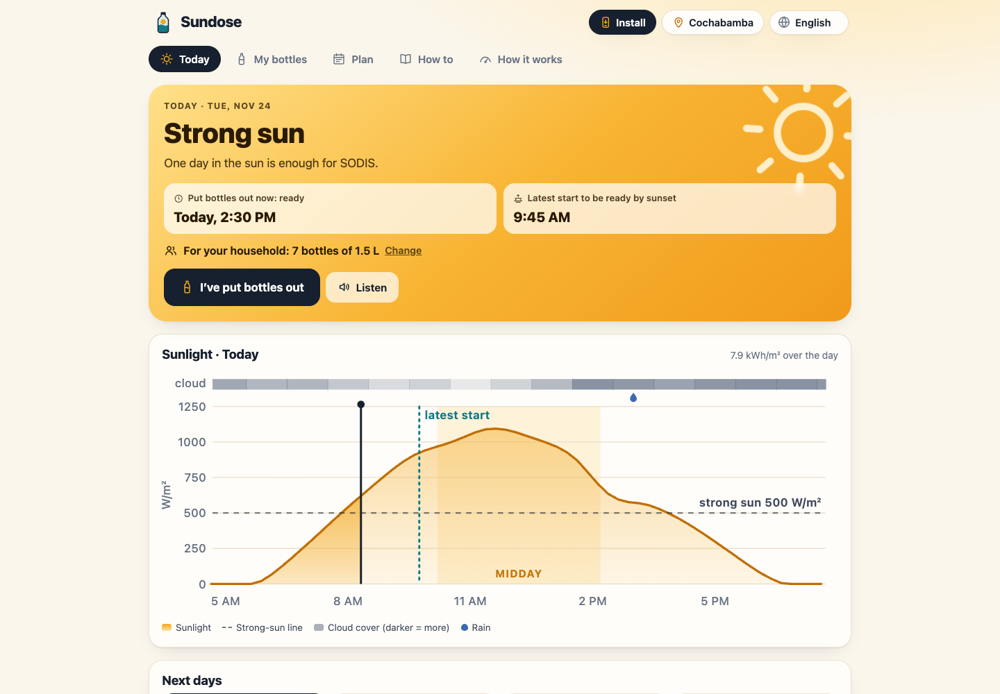
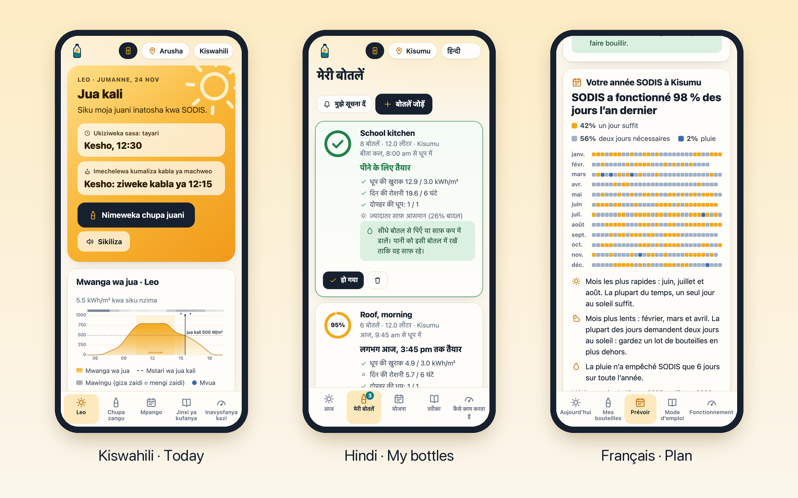
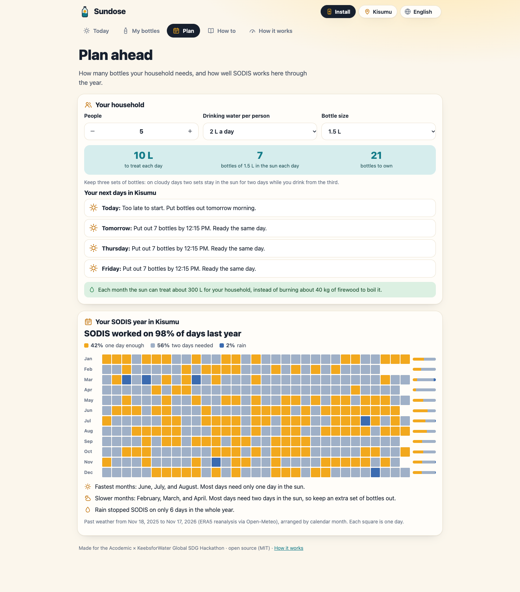

# Sundose ☀️🧴

**Know when the sun has finished treating your water.**

**Live app: https://ashank-crazy.github.io/sundose/**

Sundose is a free, offline-first web app for **SODIS (solar water disinfection)**, the WHO-recognised method of making drinking water safer by leaving clear bottles of water in the sun. It adds up the *real* sunlight falling on your bottles, using 15-minute satellite and weather-model data for your exact location, and tells you when the water is ready to drink.

Built for the **Acodemic × KeebsforWater Global SDG Hackathon**. Main goal: **SDG 6.1** (safe, affordable drinking water for all). Also **SDG 3.9** (fewer deaths from unsafe water) and **SDG 13** (water treated by the sun is water not boiled over a wood fire).







## The problem

- **2.1 billion people**, 1 in 4, still lacked safely managed drinking water in 2024, and **106 million** drink straight from rivers, lakes and ponds ([WHO/UNICEF JMP 2025](https://www.who.int/news/item/26-08-2025-1-in-4-people-globally-still-lack-access-to-safe-drinking-water---who--unicef)).
- SODIS costs almost nothing: a clear PET bottle and sunshine. But the official advice is a blunt rule of thumb: **"6 hours of sun, or 2 days if the sky is more than half cloudy"** ([Eawag SODIS manual](https://www.eawag.ch/en/department/sandec/projects/swp/solar-water-disinfection-sodis)).
- On the in-between days, which are common in the tropics during rainy seasons, families have to guess. Guess short and people drink untreated water. Guess long and they lose a day of drinking water.
- Devices that measure UV for SODIS exist, but each household has to buy one.

## What Sundose does

| | |
|---|---|
| **Today** | A verdict for the day (*Strong sun / Cloudy, leave 2 days / Rain, use another method*), when bottles put out now will be ready, and the latest start that still finishes before sunset. Includes a sunlight chart with the 500 W/m² "strong sun" line, the midday window, cloud cover and rain, and a 4-day outlook with a sunlight curve for each day. **Listen** reads the advice aloud in the chosen language, for people who find reading hard. |
| **My bottles** | Log a batch in one tap ("I've put bottles out", or "earlier, at 8:00"). Each batch has a live progress ring and three checks: sun dose, daylight hours and midday sun. It also shows the cloud and rain the bottles have had, plus an ETA. You can add a calendar reminder (.ics), get a browser alert when it's ready, and see litres treated and firewood not burned. |
| **Plan** | **Household planner:** enter the number of people, drinking water per person and bottle size. Sundose works out the litres to treat each day, the bottles to put out, the bottles to own (three sets, so cloudy two-day spells never leave the family without water), a day-by-day schedule from the forecast ("Thursday: put out 7 bottles by 12:15"), and the firewood a month of SODIS saves. **Your SODIS year:** one tap downloads the last 365 days of weather (~50 KB) and runs the same rules on every day. A calendar heatmap shows each day as one-day, two-day or rain, with the fastest, slower and rainy months spelled out, so a family or programme knows when to keep chlorine or fuel ready. |
| **How to** | Six illustrated SODIS steps, an interactive **clarity (turbidity) test**, and an honest "when SODIS is not enough" section (chemicals, muddy water, continuous rain). |
| **How it works** | The exact decision rules, where the data comes from, limits, privacy, and sources. |
| **Community** | Share the day's SODIS forecast to WhatsApp or any app, show a **QR code** that opens the same town's live forecast on a neighbour's phone, or **print a one-page notice-board sheet** with the 4-day forecast, the six steps, a printed clarity-test headline and a QR code, for villages where only one person has a smartphone. Shared links (`?p=lat,lon,name`) open straight to that town. |

### Built for where SODIS is actually used

- **Offline-first.** One forecast download (~3 KB) covers the next 4 days. After the first visit the app shell is cached by a service worker, and bottles keep being tracked with no connection. With no forecast at all, it falls back to the official Eawag schedule.
- **Read aloud.** The Listen button speaks the day's advice with the phone's own voice in the chosen language (Web Speech API), and says so when the phone has no voice for that language.
- **Tiny.** The whole app is about 65 KB compressed, uses system fonts and inline SVG, and has no framework, no build step and no trackers.
- **5 languages:** English, Español, Français, हिन्दी, Kiswahili. These cover Latin America, francophone West Africa, East Africa and South Asia, where most SODIS programmes run.
- **Readable outdoors:** a high-contrast light theme, large tap targets, and icons and colour for every verdict.
- **Private:** no accounts. Batches live in `localStorage`. The only data that leaves the phone is the location rounded to about 1 km, sent to Open-Meteo for the forecast.
- **Installable** as a PWA on Android and iOS home screens.

## How the decision works

A batch is **ready** when all three hold for the time since it went out ([`js/engine.js`](js/engine.js)):

1. **Sun dose ≥ 3.0 kWh/m².** This is the sum of 15-minute global horizontal irradiance, equivalent to the common SODIS threshold of 500 W/m² sustained for 6 hours.
2. **Daylight ≥ 6 h.** This is the Eawag rule: "at least 6 hours including noon hours".
3. **Midday sun.** The exposure must cover at least 2 of the 4 hours around solar noon. **If the mean cloud cover during exposure was above 50%, it must cover two days' middays** (Eawag's two-day rule).

The ETA is found by running the same rule forward over the forecast on a 15-minute grid. The day verdict uses the same rules, so it can't contradict the advice next to it. It is *rain* when it rains for 6 or more daylight hours, *one day* when bottles put out at sunrise would be ready by sunset, and *two days* otherwise.

**The past year** uses exactly the same rules. Sundose downloads hourly sunlight, cloud and rain for the last 365 days from the ERA5 reanalysis (via Open-Meteo's archive API), judges each day as if bottles went out at sunrise, and keeps only the verdicts (a few KB) on the phone. ERA5 often reports more than half cloud on days that still get plenty of sun; Sundose keeps Eawag's conservative two-day rule anyway, which is why the calendar shows many two-day days even in sunny places.

Sundose is guidance, not a lab test. The app says so, and it always points to boiling or chlorine when SODIS isn't appropriate.

## Tech stack

- **Frontend:** vanilla HTML, CSS and JavaScript (ES modules). No framework, no build step.
- **Data:** [Open-Meteo](https://open-meteo.com/) forecast API (15-minute shortwave radiation, hourly cloud cover and precipitation, daily sunrise, sunset and radiation sums), its historical archive API (hourly ERA5 reanalysis for the past year) and its geocoding API. All are free and need no key.
- **QR codes:** a small encoder written from the QR specification (`js/qr.js`, byte mode, level M, versions 1–10). Every version was checked by decoding it with OpenCV and with Chrome's BarcodeDetector.
- **Speech:** the browser's Web Speech API, with the phone's installed voices.
- **Offline:** a service worker for the app shell and `localStorage` for forecasts and batches.
- **PWA:** web app manifest with maskable icons.
- **Tests:** Node's built-in test runner (`node:test`). 19 tests cover the dose engine against synthetic sunny, cloudy and rainy days and a real Open-Meteo response, the household planner, the past-year verdicts and summary, the QR code structure, and translation completeness.
- **Tooling:** a tiny Chrome DevTools Protocol script renders the icons and screenshots, and a PIL script composes the phone image (`tools/`).

## Run it

```bash
npm test                      # engine + translation tests
python3 -m http.server 4173   # or: npm start
# open http://localhost:4173
```

It is deployed with GitHub Pages straight from the `main` branch, and any static host works. Serve the folder as is.

## Project layout

```
index.html          app shell
styles.css          all styles, including the print (notice-board) sheet
sw.js               offline cache
js/engine.js        the SODIS decision engine (pure functions, tested)
js/weather.js       Open-Meteo forecast, past year and offline cache
js/app.js           views, dialogs, actions
js/chart.js         SVG sunlight chart
js/i18n.js          5 languages
js/icons.js         hand-drawn SVG icons and step illustrations
js/qr.js            QR code encoder for shared links and the printed sheet
test/               node:test suites and a real forecast fixture
tools/              headless-Chrome scripts for icons and screenshots, phone composite
```

## Sources

- Eawag / Sandec, *SODIS manual* (2016): exposure schedule, turbidity limit, bottle guidance.
- *Frontiers in Water* (2025), review of SODIS irradiance and dose requirements: the ~500 W/m² threshold.
- WHO / UNICEF Joint Monitoring Programme (2025): drinking-water statistics.
- Open-Meteo: weather data (CC BY 4.0), including the ERA5 reanalysis from the Copernicus Climate Change Service for past weather.

## License

MIT. See [LICENSE](LICENSE).
